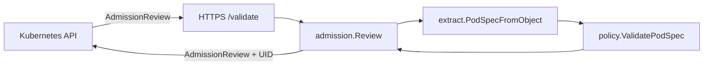

# admission-policy-webhook

Independent portfolio demo by **Habib Noor**: a bounded Go **Kubernetes validating admission webhook** focused on safe platform defaults (digest-pinned images, non-root execution, and container resources). It is not affiliated with any employer and does not represent a hiring signal.

No cluster is deployed from this repository. CI runs unit tests and schema checks only.

## What it does

- Serves **HTTPS** `POST /validate` for `admission.k8s.io/v1` `AdmissionReview` payloads.
- Echoes `request.uid` on every admission response.
- Exposes **`/healthz`** and **`/readyz`** JSON health endpoints.
- Reads request bodies with a **3 MiB** cap; malformed reviews fail closed with explicit errors.
- Enforces policy on **Pod** specs and pod templates inside **Deployment, ReplicaSet, StatefulSet, DaemonSet, Job, CronJob**.
- **Unsupported kinds** (e.g. `ConfigMap`, `Service`) are **allowed** and documented as out of scope; **malformed supported kinds** are **denied**.

## Policy (exact rules)

Documented in code in [`internal/policy/doc.go`](internal/policy/doc.go).

| Area | Regular / init | Ephemeral |
|------|----------------|-----------|
| Image | Must include `@sha256:` + **64 lowercase hex** digits; **no digest → deny**; tag **`latest` → deny** (including `image:latest@sha256:…`) | Same image rules |
| `runAsNonRoot` | Effective value must be **true** (container `securityContext` overrides pod `securityContext`) | Same |
| `runAsUser` | Effective **0 → deny** (inheritance same as above) | Same |
| CPU / memory | **Requests and limits required**; limits **≥** requests (`resource.Quantity`) | **Not required**; if set, validate pair and limits **≥** requests |

Digest pinning is a **supply-chain hygiene** control; it does **not** prove authenticity of the image or registry.

## Architecture



Packages:

- `cmd/webhook` — TLS HTTP server
- `internal/server` — routing, bounded reads
- `internal/admission` — decode/review, UID echo, scope
- `internal/extract` — kind-specific pod template paths (incl. `spec.jobTemplate.spec.template.spec` for CronJob)
- `internal/policy` — validation rules

## Commands

```bash
# Unit tests (as CI)
go test -race ./...
go vet ./...

# Local TLS material (gitignored private key)
./scripts/gen-certs.sh

# Run webhook locally
go run ./cmd/webhook --tls-cert=certs/tls.crt --tls-key=certs/tls.key

# Docker image (CI job)
docker build -t admission-policy-webhook:local .

# Manifest schema check (no cluster)
kubeconform -strict -kubernetes-version 1.29.0 deploy/*.yaml
```

### `ValidatingWebhookConfiguration` notes

See [`deploy/validating-webhook-configuration.yaml`](deploy/validating-webhook-configuration.yaml):

- **`failurePolicy: Fail`** — reject API requests if the webhook is unavailable (*fail closed*).
- **`sideEffects: None`**, **`timeoutSeconds: 5`**, **`admissionReviewVersions: [v1]`**.
- **`caBundle`**: PEM of the signing CA for the webhook serving cert, base64-encoded (printed by `scripts/gen-certs.sh`).

Optional local exercise: [`deploy/kind-guide.md`](deploy/kind-guide.md) (not claimed as deployed here).

## Design decisions

1. **Fail closed** on malformed in-scope objects and on policy violations — prioritizes safety over availability when data is ambiguous.
2. **Explicit allow-list of kinds** — avoids guessing paths for CRDs or unrelated resources.
3. **No in-cluster code generation** — policies are plain Go for reviewability and table-driven tests.
4. **Bounded HTTP** — limits body size and server timeouts to reduce DoS surface against the webhook.
5. **Distroless runtime image** — minimal attack surface in the reference Dockerfile.

## Limitations

- **Availability tradeoff**: `failurePolicy: Fail` can block workload changes if the webhook is down.
- **Scope gaps**: No validation for namespaces, RBAC, network policy, or arbitrary CRD pod templates unless you extend `internal/extract`.
- **Digest ≠ trust**: A pinned digest does not validate signature, provenance, or vulnerability status.
- **Image tag parsing**: Port-heavy references use the segment before `@`; exotic reference forms may need hardening.
- **Connect operation** / subresource admissions are not specialized.

## License & attribution

MIT — see [LICENSE](LICENSE). Repository developed with generic AI coding assistance; no model names are listed, and this is **not** a claim that Habib personally reviewed every line in a production sense beyond normal open-source maintenance.

## Further reading

- [`artifacts/interview-notes.md`](artifacts/interview-notes.md) — modules, tradeoffs, 30 Q&A, failure experiments.
